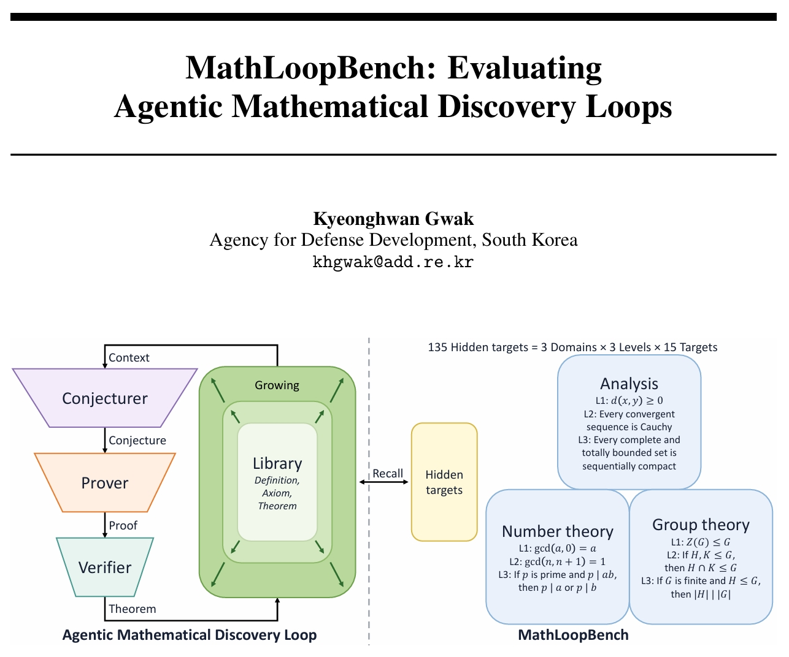

  

Our paper, *MathLoopBench: Evaluating Agentic Mathematical Discovery Loops*, has been accepted to the 6th Workshop on Mathematical Reasoning and AI (<a href="https://mathai-2026.github.io/" target="_blank" rel="noopener noreferrer">NeurIPS Workshop MATH-AI</a>) 2026! [<a href="https://openreview.net/pdf?id=HtUTpiDT3k" target="_blank" rel="noopener noreferrer">Paper</a>]

This paper presents a benchmark for mathematical discovery loops, which must decide what is worth proving before proving it. Each loop grows a small Lean 4 library under a fixed budget and is scored by how many hidden target theorems it recovers.
