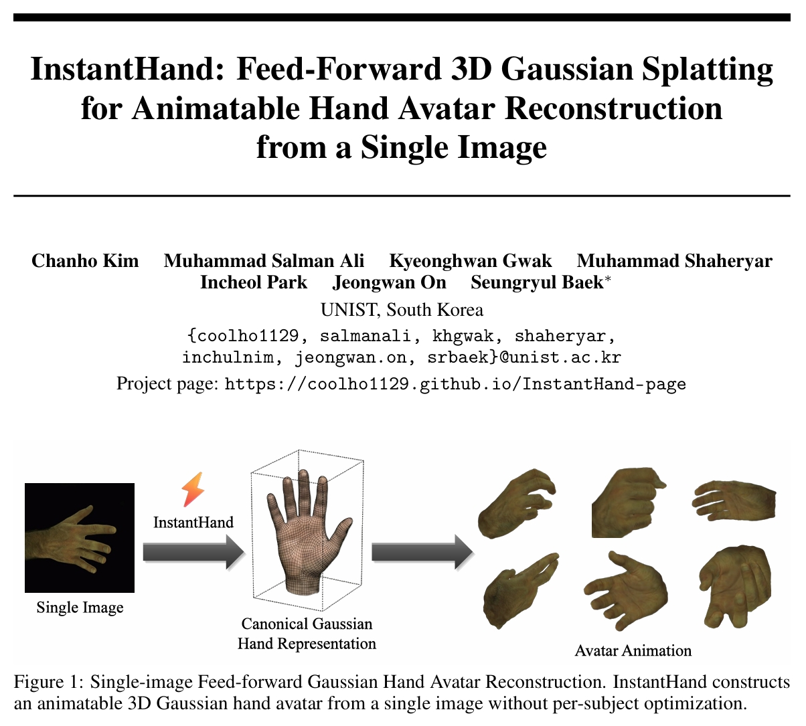

  

Our paper, *InstantHand: Feed-Forward 3D Gaussian Splatting for Animatable Hand Avatar Reconstruction from a Single Image*, has been accepted to <a href="https://neurips.cc/virtual/2026/loc/sydney/poster/150475" target="_blank" rel="noopener noreferrer">NeurIPS 2026</a>! [<a href="https://arxiv.org/pdf/2611.08330" target="_blank" rel="noopener noreferrer">Paper</a>][<a href="https://github.com/coolho1129/InstantHand" target="_blank" rel="noopener noreferrer">Code</a>][<a href="https://coolho1129.github.io/InstantHand-page/" target="_blank" rel="noopener noreferrer">Project Page</a>]

This paper presents a method for building an animatable 3D Gaussian hand avatar from a single image in one forward pass, without per-subject optimization. It builds an avatar within seconds, renders in real time, and achieves quality comparable to per-subject optimized methods.
